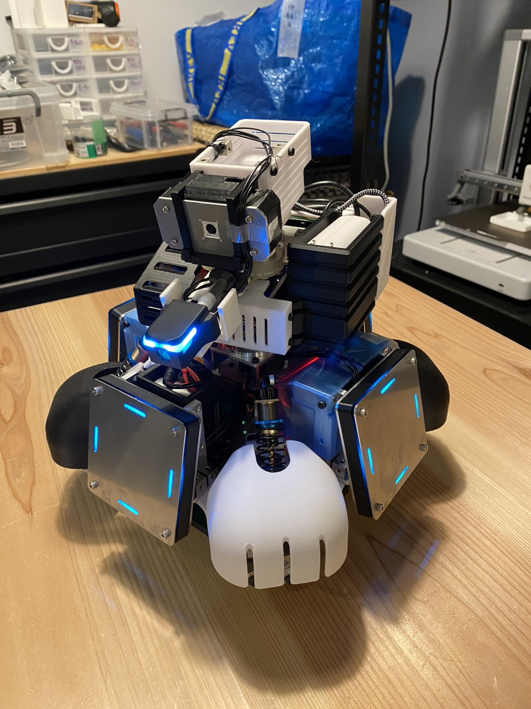
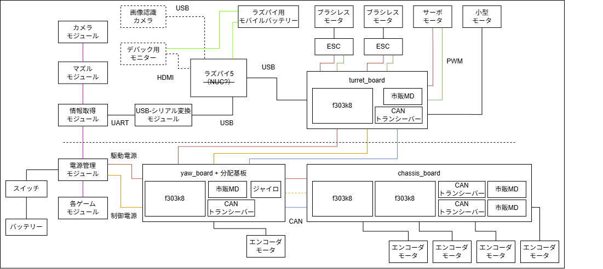

# alpha

ATTRACTS 向け対戦ロボット alpha の機体管理リポジトリ。現行は proto2 世代で、本書は proto2 について書く。
機体全体の構成、基板、配線、関連リポジトリへの入口をここに集約する。



## 関連リポジトリ

| 役割 | リポジトリ | 備考 |
|---|---|---|
| 砲塔基板 | [proto2_turret_pcb](https://github.com/rabbits-robotics/proto2_turret_pcb) | [v1.0](https://github.com/rabbits-robotics/proto2_turret_pcb/releases/tag/v1.0)（Rev B、2025-02-22 発注） |
| Yaw 軸基板 | [proto2_yaw_pcb](https://github.com/rabbits-robotics/proto2_yaw_pcb) | [v1.0](https://github.com/rabbits-robotics/proto2_yaw_pcb/releases/tag/v1.0)（Rev B、2025-09-07 発注） |
| 車体分配基板 | [proto2_chassis_pcb](https://github.com/rabbits-robotics/proto2_chassis_pcb) | [v1.0](https://github.com/rabbits-robotics/proto2_chassis_pcb/releases/tag/v1.0)（2024-11-11 発注） |
| 砲塔ファームウェア | [proto2_turret](https://github.com/rabbits-robotics/proto2_turret) | Nucleo F303K8 |
| Yaw 軸ファームウェア | [proto2_yaw](https://github.com/rabbits-robotics/proto2_yaw) | Nucleo F303K8 |
| 前輪ファームウェア | [proto2_main](https://github.com/rabbits-robotics/proto2_main) | Nucleo F303K8。構成の説明もここにある |
| 後輪ファームウェア | [proto2_chassis](https://github.com/rabbits-robotics/proto2_chassis) | Nucleo F303K8 |
| 共通ライブラリ | [rabcl](https://github.com/rabbits-robotics/rabcl) | ファームと ROS 2 で共用 |
| ROS 2 ワークスペース | [rabbits_ws](https://github.com/rabbits-robotics/rabbits_ws) | `alpha.repos` は未作成 |
| 機体固有設定（launch / パラメータ / URDF） | [rabbits_description](https://github.com/rabbits-robotics/rabbits_description) | |
| メカ CAD | 本リポジトリの Releases | SolidWorks 一式を zip で添付（CERN-OHL-P-2.0）。添付予定 |

## システム構成

Nucleo F303K8 を 4 枚使い、Raspberry Pi 5 からの UART 指令を砲塔基板が受けて CAN で各基板に分配する。

```
[ Raspberry Pi 5 ]
  │ UART（115200 bps、DMA）
  ▼
[ proto2_turret ]  ピッチ・装填・射出ローラーを制御
  │ CAN（400 kbps）
  ▼
[ proto2_yaw ]     Yaw 軸を制御し、オムニ駆動の各輪速度を計算して前後へ分配
  ├── CAN → [ proto2_main ]     前右・前左輪
  └── CAN → [ proto2_chassis ]  後右・後左輪
```



配線図・系統図の元ファイルは [diagrams/](./diagrams/) に置いている（`wiring.drawio` / `wiring_diagram.drawio` / `system.drawio` / `system_overview.drawio`）。

## 基板構成

| 基板 | 役割 |
|---|---|
| proto2_turret | 砲塔。Nucleo F303K8 を載せ、UART を受けて CAN に中継。ピッチサーボ、装填モータ（DRV8835）、射出 ESC × 2 を直接制御 |
| proto2_yaw | Yaw 軸。Nucleo F303K8 と BNO055 を載せ、Yaw 軸モータの位置制御と、砲塔・車体への電源中継 |
| proto2_chassis | 車体。Nucleo F303K8 を 2 枚載せ（前輪用 = proto2_main ファーム、後輪用 = proto2_chassis ファーム）、各 2 輪のモータドライバを制御。車体側の電源・CAN 分配を兼ねる |

## アクチュエータ一覧

| 部位 | モータ | 駆動 |
|---|---|---|
| 車輪 | JGA25-370 × 4（ギヤ比 34、エンコーダ付き）、オムニ 4 輪 | 市販 MD、PWM + エンコーダ速度制御 |
| 首 Yaw | JGA25-370（ギヤ比 75 × 38/25） | 市販 MD、PWM + エンコーダ位置制御。BNO055 で補正 |
| 首 Pitch | LD-20MG サーボ | PWM 400 Hz、位置制御 |
| 射出 | ESC × 2 | PWM 50 Hz。待機 1000 µs / 射出 1200 µs |
| 装填 | DC モータ | 市販 MD、PWM 1 kHz |

## 共通仕様

| 項目 | 値 |
|---|---|
| 上位コントローラ | Raspberry Pi 5（UART） |
| CAN ビットレート | 400 kbps |
| 制御周期 | 100 Hz |
| CAN 送信周期 | 40 Hz（turret / yaw） |

## 設計メモ

機体全体に関わる設計判断は `docs/` に日付付きで残す。

## ライセンス

このリポジトリの文書は © Rabbits Robotics、[CC BY 4.0](./LICENSE)。
Releases に添付するメカ CAD は CERN-OHL-P-2.0（リリースノートに明記）。
